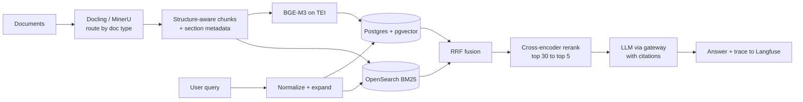
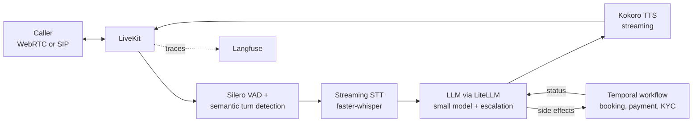
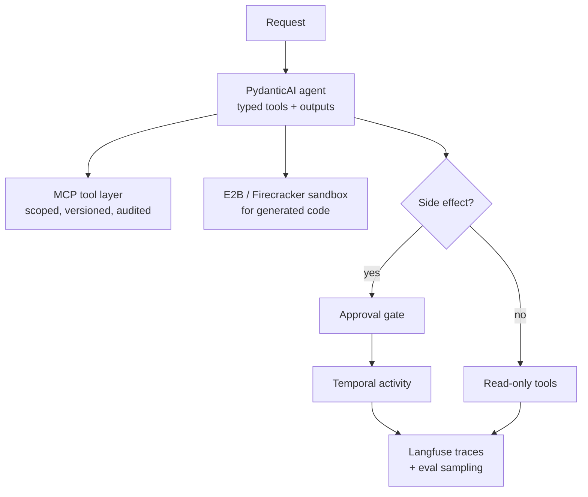

# The Production AI Stack

**An opinionated map of what actually runs in production. Every pick comes from systems I have shipped or audited, with the why, the when-not, and the traps. No hype.**

Last major revision: July 2026.

I have spent the last few years building LLM systems for enterprises in the Gulf and beyond: RAG over 100M+ pages, real-time Arabic voice agents, multi-agent backends, and cost-reduction projects that took monthly bills from $52K to under $5K. This repo is the reference I wish I had when I started. It is not a list of everything that exists. It is a list of what I would reach for today, and what I would deliberately skip.

**How each layer is written:**

- **Default**: what I reach for first, and why.
- **Switch when**: the constraint that justifies an alternative.
- **Traps**: things that bit me or teams I worked with.

**My biases, stated upfront:** boring technology, Postgres-first, self-hostable with a managed escape hatch, debuggable over clever, and everything must be replayable. If you cannot replay it, you cannot debug it.

---

## Table of contents

1. [Principles](#principles)
2. [The stack at a glance](#the-stack-at-a-glance)
3. [Model serving (self-hosted inference)](#1-model-serving)
4. [Embeddings and rerankers](#2-embeddings-and-rerankers)
5. [Gateway and routing](#3-gateway-and-routing)
6. [Retrieval and storage](#4-retrieval-and-storage)
7. [Document ingestion and parsing](#5-document-ingestion-and-parsing)
8. [Chunking and indexing strategy](#6-chunking-and-indexing-strategy)
9. [Orchestration and durable execution](#7-orchestration-and-durable-execution)
10. [Agent frameworks and protocols](#8-agent-frameworks-and-protocols)
11. [Structured output](#9-structured-output)
12. [Voice (real-time)](#10-voice-real-time)
13. [Observability and evals](#11-observability-and-evals)
14. [Guardrails and security](#12-guardrails-and-security)
15. [Fine-tuning and training](#13-fine-tuning-and-training)
16. [Caching and cost control](#14-caching-and-cost-control)
17. [Arabic and multilingual notes](#15-arabic-and-multilingual-notes)
18. [Reference architectures](#16-reference-architectures)
19. [Things I would skip in 2026](#17-things-i-would-skip-in-2026)

---

## Principles

1. **The model is maybe 20% of the system.** Retrieval quality, parsing quality, orchestration, and evals decide whether the product works. Model swaps are a config change if the rest of the stack is clean.
2. **Start with Postgres. Leave when you have numbers.** Most teams buy a vector database, a feature store, and a queue before they have a single eval. Postgres plus pgvector plus a boring queue covers you further than vendors want you to believe.
3. **Every layer needs an eject path.** Prefer tools with an open-source core and a managed option. You want the choice between "we run it" and "we pay for it" to stay open in both directions.
4. **If you cannot replay it, you cannot debug it.** Traces, versioned prompts, deterministic workflows, seeded evals. Non-negotiable once real money flows through the system.
5. **Latency budgets are architecture.** Decide the end-to-end budget first (a voice agent has ~800ms, a document pipeline has minutes), then pick components that fit. Not the other way around.
6. **Evals before dashboards.** A dashboard tells you something happened. Only an eval set tells you whether it was good. 50 hand-labeled examples beat any LLM-as-judge you have not calibrated.
7. **Autonomy is a liability budget.** Every degree of freedom you give an agent is something you must observe, bound, and be able to roll back. Spend it deliberately.

---

## The stack at a glance

| Layer | Default | Strong alternative | Managed escape hatch |
|---|---|---|---|
| Inference serving | vLLM | SGLang | Any OpenAI-compatible provider |
| Embedding serving | TEI | Infinity | Provider embedding APIs |
| Gateway | LiteLLM (pinned + verified) | Bifrost | OpenRouter, cloud AI gateways |
| Vector + hybrid retrieval | Postgres + pgvector | Qdrant, OpenSearch (BM25 leg) | Qdrant Cloud, managed Postgres |
| Parsing | Docling | MinerU | Azure Doc Intelligence, Mistral OCR |
| Durable execution | Temporal | Restate, DBOS | Temporal Cloud |
| Agent framework | PydanticAI | LangGraph | Claude/OpenAI Agent SDKs |
| Structured output | Server-side constrained decoding (xgrammar) | instructor | Provider structured outputs |
| Voice transport | LiveKit | Pipecat | LiveKit Cloud, Daily |
| STT | faster-whisper | Parakeet family | Deepgram, ElevenLabs, Azure |
| TTS | Kokoro | Chatterbox family | ElevenLabs, Azure |
| Observability | Langfuse | Arize Phoenix | Langfuse Cloud, LangSmith |
| Evals | promptfoo + golden set | Ragas, DeepEval | Braintrust, Confident AI |
| Guardrails | Layered: Presidio + classifier + policy | NeMo Guardrails | Provider moderation APIs |
| Fine-tuning | Unsloth (LoRA) | Axolotl, LLaMA-Factory | Provider fine-tuning APIs |

---

## 1. Model serving

Self-hosting only makes sense when you have sustained volume, data-residency requirements, or a narrow task where a small model wins. In the Gulf, data residency alone (SDAIA/PDPL in KSA, similar regimes elsewhere) forces this decision more often than cost does.

**Default: [vLLM](https://github.com/vllm-project/vllm)**

Why: continuous batching, PagedAttention, automatic prefix caching, OpenAI-compatible server, day-0 support for almost every open model, multi-LoRA serving, and the broadest hardware story (NVIDIA, AMD, TPU, Trainium, Gaudi). It is the default backend for a large share of the world's OpenAI-compatible endpoints, which means the failure modes are well documented. When something breaks at 3am, someone on GitHub has already seen it.

**Switch to [SGLang](https://github.com/sgl-project/sglang) when:**

- Your workload is prefix-heavy: multi-turn chat, RAG with big shared system prompts, agent loops. RadixAttention gives real gains here that vLLM's prefix cache does not fully match.
- You depend on structured JSON output at scale. SGLang's compressed-FSM constrained decoding overlaps grammar masking with the forward pass, so constraint enforcement is close to free.
- You serve DeepSeek-family models. SGLang has consistently led on those.

It is not a niche pick anymore: SGLang runs production inference at xAI, LinkedIn, and Cursor among others. The honest summary: vLLM for breadth and unique-prompt batch work, SGLang for shared-prefix and structured-output shapes.

**Other tiers:**

- **TensorRT-LLM**: highest throughput on NVIDIA if you can absorb long engine compilation on every model change. Worth it for one stable model at very high volume, painful for a fleet that iterates.
- **NVIDIA Dynamo / llm-d**: orchestration above the engine (disaggregated prefill/decode, KV-aware routing) for multi-node scale. You will know when you need this; do not start here.
- **llama.cpp / Ollama**: local dev, edge, and demos. Not a production serving tier for concurrent traffic. I have seen teams ship Ollama behind an API and then discover what happens at 20 concurrent users.

**Traps:**

- Benchmark with **your** traffic shape. ShareGPT-style benchmarks say nothing about your prefix ratios, output lengths, or concurrency curve. TTFT and total throughput trade off; decide which one your product feels.
- Quantization (FP8/AWQ/GPTQ) must be evaluated on **your tasks**, not MMLU. Arabic generation quality in particular degrades unevenly under aggressive quantization; I have seen a model pass English evals and start dropping diacritics-sensitive distinctions in Arabic after INT4.
- Keep the engine version pinned and upgrade deliberately. Scheduler changes between minor versions can shift your latency distribution.

---

## 2. Embeddings and rerankers

**Serving, default: [TEI (Text Embeddings Inference)](https://github.com/huggingface/text-embeddings-inference)**, with **[Infinity](https://github.com/michaelfeil/infinity)** as the flexible alternative when you need models TEI does not cover. Both give you batched, production-grade serving for embedding and reranker models; do not embed inside your application process.

**Models:** [BGE-M3](https://huggingface.co/BAAI/bge-m3) remains my multilingual default because it produces dense, sparse, and multi-vector representations from one model, which maps perfectly onto hybrid retrieval. The Qwen embedding family and Jina v3/v4 are strong alternatives; run all candidates on a retrieval eval built from your own corpus before choosing. Leaderboard rank does not transfer reliably across domains or dialects.

**Rerankers:** a cross-encoder reranker (bge-reranker-v2-m3 or the Qwen reranker family) on the top 30-50 candidates is the single highest-ROI addition to most RAG systems. It routinely fixes more quality problems than switching embedding models.

**Traps:**

- Rerankers eat your latency budget. Budget ~50-150ms for a reranking pass and cap candidate count accordingly.
- Do not embed garbage. Parsing and chunking quality dominate embedding model choice (see layers 5 and 6).
- If you change embedding models you re-embed everything. Version your index with the model name from day one.
- Matryoshka-style dimension truncation is a legitimate cost lever, but validate recall at the truncated dimension on your eval set, not the paper's.

---

## 3. Gateway and routing

One URL in front of every model, whether provider APIs or your own vLLM boxes. This is where budgets, keys, fallbacks, and routing live. In multi-provider cost projects, this layer is where most of the savings get implemented: route the cheap 80% of traffic to a small model, escalate the rest.

**Default: [LiteLLM](https://github.com/BerriAI/litellm), with eyes open.**

Why: broadest provider coverage by far, virtual keys, per-team budgets, fallbacks, spend tracking, and an OpenAI-compatible surface that everything else in this document speaks natively.

The eyes-open part: in March 2026 a supply-chain attack published two malicious LiteLLM versions to PyPI (1.82.7 and 1.82.8) carrying a credential stealer, outside the project's normal release process. The versions were pulled, but the lesson stands for any Python package that sits between your applications and your API keys: pin exact versions, install from a hash-verified lockfile, mirror through an internal registry, and never auto-upgrade the gateway. This is a gateway-tier discipline, not a reason to panic-migrate.

**Switch to [Bifrost](https://github.com/maximhq/bifrost) when:** you are latency-sensitive at high RPS. It is a Go gateway (Apache 2.0) with microsecond-scale overhead where Python proxies add milliseconds and hit GIL contention. Note that most "LiteLLM vs Bifrost" content online is written by Bifrost's vendor; the performance gap is real, but evaluate feature parity for your needs (provider coverage, budget hierarchy) yourself.

**Also fine:** a thin custom router if you genuinely use two providers and need none of the governance. OpenRouter or a cloud AI gateway if you want zero infrastructure and can accept the data path.

**Traps:**

- The gateway is a single point of failure by design. Run replicas behind a load balancer and keep a direct-to-provider break-glass path.
- Put the gateway's own latency on a dashboard. Teams discover 100ms of proxy overhead months late.
- Log prompts at the gateway only if your PII story allows it. This is the easiest place to accidentally build a compliance problem.

---

## 4. Retrieval and storage

**Default: Postgres + [pgvector](https://github.com/pgvector/pgvector).**

Why: your relational data is already there, so filtered retrieval becomes a SQL join instead of a synchronization problem between two databases. One backup story, one access-control story, one operational skill set. With HNSW and the 0.8/0.9-era improvements (including sparse vector support), pgvector holds up much further than its reputation suggests; tens of millions of vectors is a realistic ceiling before you need to think hard, and most systems never get there.

**Switch to [Qdrant](https://github.com/qdrant/qdrant) when:** vectors are the center of the workload rather than a column in it. Heavy filtered search (filters evaluated inside HNSW traversal, not after), built-in scalar/product/binary quantization for memory control, native multi-vector support (which matters if you go the ColBERT/ColPali route), clean multi-tenancy. It is the best operability-to-performance ratio among the dedicated engines.

**The rest of the map:**

- **OpenSearch / Elasticsearch**: not for vectors primarily, but as the BM25 leg of hybrid retrieval. For morphologically rich languages this leg is not optional (see the Arabic section).
- **Milvus**: genuine billion-scale, at the price of operating a distributed system. Do not deploy it for data you might have in three years.
- **LanceDB**: embedded, columnar, good for edge/desktop and data-lake-adjacent workflows.
- **Chroma**: prototyping. It has improved, but I still would not carry it into production when the above exist.

**Hybrid retrieval is the default pattern, not an optimization:** dense + BM25, fused with RRF, then reranked. On every Arabic system I have benchmarked, dropping the lexical leg costs double-digit recall on named entities, numbers, and rare terms. English gets away with dense-only more often; you should still not bet on it.

**Traps:**

- pgvector: HNSW build parameters are fixed at index creation, so get `m` and `ef_construction` right before indexing millions of rows; monitor memory during builds; always shape queries as `ORDER BY embedding <=> $1 LIMIT k` so the index is actually used.
- Qdrant: payload indexes are not automatic; create them explicitly for every field you filter on, or filtered queries silently degrade.
- Measure recall@k on your own labeled set. Vendor benchmarks are run on vendor hardware with vendor-favorable data.
- Metadata filter selectivity cliffs: a filter matching 0.1% of the corpus behaves completely differently from one matching 50%. Test both.

---

## 5. Document ingestion and parsing

The silent failure mode of most RAG systems. Retrieval metrics look mediocre, everyone tunes embeddings, and the actual problem is that the parser destroyed every table three months ago. Evaluate parse quality **before** touching anything downstream.

**Default: [Docling](https://github.com/docling-project/docling)** (IBM, MIT license)

Why: the best document-hierarchy preservation in open source, strong table structure recognition (TableFormer), runs fully local on CPU, first-party integrations with the major frameworks, and a clean structured output (DoclingDocument) that maps directly onto structure-aware chunking. For born-digital PDFs and Office documents in a regulated or air-gapped environment, this is the pick.

**Switch to [MinerU](https://github.com/opendatalab/MinerU) when:** documents are hostile. Cross-page tables (which Docling splits into two objects), heavy formulas, scanned input, complex multi-column layouts. MinerU's VLM-backed pipeline handles these out of the box and its OCR backend keeps improving. The cost is a heavier runtime that wants a GPU for throughput.

**Also on the map:**

- **[marker](https://github.com/datalab-to/marker)**: fast PDF-to-Markdown, a good middle option; check the license tier against your revenue.
- **VLM-as-parser** (olmOCR, PaddleOCR-VL and the current wave of OCR-tuned VLMs): the frontier for scanned and handwritten content. Costs more per page; use as the fallback tier, not the default path.
- **Managed** (Azure Document Intelligence, Mistral OCR): fine when data residency allows; often it does not, and that is precisely why the local-first parsers matter.
- **Visual retrieval** (ColPali/ColQwen-style late-interaction over page images): skips parsing entirely for chart-heavy corpora. Pairs with Qdrant multi-vector collections. Powerful, but storage- and compute-expensive; justify it with an eval.

**Traps:**

- The PDF text layer lies. Reading order, hyphenation, headers/footers bleeding into body text. Never trust raw text extraction for anything with layout.
- Route by document type: born-digital through the structural parser, scanned through OCR/VLM. One pipeline for both wastes money and quality.
- Tables are where RAG dies. Test specifically: can the system answer a question whose answer lives in row 47, column 3, of a table spanning a page break?
- Arabic OCR remains genuinely hard (see the Arabic section). Budget for it; do not discover it in week six.

---

## 6. Chunking and indexing strategy

Chunking decisions move retrieval metrics more than embedding model choice. In benchmarks I have run on Arabic corpora, going from fixed-size to structure-aware chunking moved recall more than any model swap.

**Defaults that hold up:**

- **Structure-aware chunking** from the parser's hierarchy (sections, headings, tables as atomic units) instead of fixed windows. This is the main reason to use Docling/MinerU in the first place.
- **Parent-child retrieval**: embed small chunks for precision, return the parent section for context. Cheap to implement, consistently helps.
- **Contextual enrichment** (prepending a document-level summary or section path to each chunk before embedding): meaningful gains, at a one-time LLM cost per corpus. Worth it for high-value corpora, skip for high-churn ones.
- **Late chunking** on long-context embedding models: worth an experiment when your corpus has heavy cross-references.

Shameless plug, clearly labeled: I maintain [ChunkWise](https://github.com/h9-tec/chunkwise), a chunking library born from exactly these production lessons, with Arabic-aware handling.

**Trap:** chunk size is corpus-specific. Legal contracts, chat logs, and API docs have different natural units. Tune it with your eval set; there is no universal 512.

---

## 7. Orchestration and durable execution

Anything multi-step that touches money, side effects, or long waits belongs in a durable execution engine, not in a chain of try/excepts.

**Default: [Temporal](https://github.com/temporalio/temporal)** (MIT)

Why: event-sourced workflow state, so a crashed worker resumes from the last completed step instead of replaying (and re-paying for) the whole pipeline. Retry policies per activity, workflows that can sleep for months waiting on a human signal, child workflows for fan-out, and full replayable history for debugging. Battle-tested at very large scale; agents on top of it inherit all of it.

**The determinism constraint is the whole mental model:** workflow code must be deterministic, so every LLM call, tool call, and HTTP request lives in an activity. Internalize this early and Temporal is pleasant; fight it and you will hate every day.

**Lighter alternatives:**

- **[Restate](https://github.com/restatedev/restate)**: single Rust binary, no external database, same durable-execution model, explicitly courting agent workloads. My pick when a Temporal cluster is too much ceremony.
- **[DBOS](https://github.com/dbos-inc/dbos-transact-py)**: durability as a library with Postgres as the log. The lightest possible entry; great fit if you are already Postgres-first.
- **[Hatchet](https://github.com/hatchet-dev/hatchet)** / **[Inngest](https://github.com/inngest/inngest)**: Postgres-backed queues and event-driven durable functions respectively; good middle ground.
- **Celery + Redis** is still fine for stateless fire-and-forget jobs. It is not fine for a 12-step agent pipeline with compensation logic; be honest about which one you have.

**Trap:** put idempotency keys on every side-effecting activity from day one. Retries are a feature until they double-charge a customer.

---

## 8. Agent frameworks and protocols

Blunt take first: most production "agents" are a loop, tools, and a state machine. The framework's job is to give you typing, persistence, and observability without taking control flow away from you. The hand-rolled while-loop era is over, but so is the 2024-era hype stack.

**Default: [PydanticAI](https://github.com/pydantic/pydantic-ai)**

Why: thin, type-safe, dependency-injected, testable like normal Python. The type checker catches malformed tool signatures and outputs at dev time, which in practice removes a whole class of production incidents. Since v1 (late 2025) it has been genuinely production-ready and it keeps getting sharper. Around 90% of real agent use cases are linear or close to it; this handles them with the least ceremony.

**Switch to [LangGraph](https://github.com/langchain-ai/langgraph) when:** the workflow truly is a graph: branching approvals, pause/resume with checkpoints, multi-actor state that must be audited. It hit 1.0 in late 2025 and is the enterprise default for exactly these shapes. Accept the learning curve (weeks, not days) only when the problem demands the graph.

A pattern I use and keep seeing elsewhere: **PydanticAI for the agent logic, LangGraph or Temporal for the orchestration around it.** They compose better than either does alone. If the workflow carries real money, the outer layer is Temporal regardless.

**The rest of the map, honestly:**

- **Claude Agent SDK / OpenAI Agents SDK**: excellent if you are committed to that vendor; the price is portability.
- **Microsoft Agent Framework** (the Semantic Kernel + AutoGen merger): the .NET/Azure-shop answer.
- **CrewAI**: fastest demo-to-prototype path; role-based crews present well to stakeholders. Teams consistently outgrow it when they need deterministic control. Know which phase you are in.
- **smolagents**: minimal code-agent loop, good for research and internal tooling.

**Protocols: [MCP](https://modelcontextprotocol.io) won.** Donated to the Linux Foundation's agentic AI foundation in late 2025, adopted across every major platform. Treat it as the standard interface for tools and data access. But treat MCP servers as third-party code with credentials, because that is what they are:

- Inventory every server; most MCP sprawl today is shadow IT on developer laptops.
- Prefer Streamable HTTP remotes with OAuth 2.1 + PKCE over ad-hoc stdio processes for anything shared.
- Pin server versions like any dependency; a poisoned server in the chain owns everything downstream.
- Scope write access separately from read access, always behind approval gates.

**Shared MCP access governance:** [Speakeasy control plane](https://www.speakeasy.com/) is an option when shared MCP servers need identity-provider roles, per-tool permissions, security policies, and centralized audit logs. The [MoonPay deployment write-up](https://aaif.io/blog/ai-governance-in-a-regulated-industry-how-moonpay-brought-mcp-sprawl-under-control), coauthored by the customer and vendor, describes this setup in production. Gateway controls cover routed calls; keep separate sandbox and egress restrictions for code execution and direct network access.

**Agent memory** (Mem0, Zep/Graphiti, Letta): treat it as a retrieval problem with a write policy, not magic. Start with scoped summaries + your existing retrieval stack; adopt a memory product only when you can articulate what it does that they do not.

**Sandboxing:** if an agent executes generated code, it runs in a real sandbox (E2B, Daytona, or your own Firecracker/gVisor setup). Not a subprocess with a timeout. This is the least negotiable line in this document.

---

## 9. Structured output

**Default: server-side constrained decoding.** If you serve your own models, xgrammar-backed guided decoding in vLLM/SGLang makes schema compliance near-guaranteed at near-zero cost, and SGLang in particular has made this a headline strength. This beats client-side retry loops on every axis: latency, cost, and reliability.

**On provider APIs:** native structured-output modes first, [instructor](https://github.com/567-labs/instructor) as the portable layer with validation and retries across providers. BAML is worth a look if your team wants schema-as-DSL with codegen.

**Trap:** constraining decoding too early can hurt reasoning quality. The pattern that works: let the model think in free text, then constrain only the final answer block. Also: your schema is a prompt. Field names and descriptions steer the model; write them like documentation, not like a database migration.

---

## 10. Voice (real-time)

The layer where physics shows up. A natural conversation needs voice-to-voice response around 500-800ms; feel-instant targets push individual components under 300ms. Every choice below is downstream of that budget.

**Transport and agent runtime, default: [LiveKit](https://github.com/livekit/livekit) + LiveKit Agents.** WebRTC SFU infrastructure plus a voice-agent framework (VAD, turn detection, STT/LLM/TTS pipeline, SIP for telephony) in one coherent stack, Apache 2.0, with a managed cloud when you do not want to run SFUs. **[Pipecat](https://github.com/pipecat-ai/pipecat)** is the vendor-neutral alternative when you want finer pipeline control or are already on Daily.

**STT:**

- **[faster-whisper](https://github.com/SYSTRAN/faster-whisper)** remains the self-hosted default: mature, multilingual, well understood. Wrap it for streaming with partial hypotheses.
- NVIDIA's Parakeet/Canary family for top English accuracy-per-latency on GPU.
- Managed (Deepgram, Azure, ElevenLabs) when you need SLAs and streaming polish yesterday. For Arabic dialects, benchmark managed vendors on **your** audio; marketing WER numbers are MSA-flavored (see the Arabic section).

**TTS, the layer that changed most since 2024. Open-source stopped being the compromise option:**

- **[Kokoro](https://huggingface.co/hexgrad/Kokoro-82M)** (Apache 2.0, 82M params): my default for latency-sensitive agents. Real-time on modest hardware, CPU-viable, absurdly good quality for its size. No voice cloning, which for many products is a feature.
- **Chatterbox family** (MIT): zero-shot cloning with genuinely competitive quality; it has beaten commercial leaders in public blind preference tests. The permissive license is the point: most "open" TTS with cloning is research-licensed.
- Expressive/dialogue tier (Orpheus, Dia, Higgs Audio and friends): evaluate per use case; this subfield turns over every quarter.
- **License traps live here more than anywhere else in the stack.** Coqui XTTS is CPML (non-commercial). Fish/OpenAudio tiers are research-licensed. Read the license before the demo, not after.

**Turn detection:** semantic turn detection (LiveKit's turn detector, Pipecat's Smart Turn) over raw silence-based VAD. Silero VAD for the low-level gate. Nothing makes a voice agent feel broken faster than interrupting the user mid-thought; nothing makes it feel slow like waiting 800ms of silence to be sure.

**Architecture note:** keep the real-time loop and the business logic separate. LiveKit/Pipecat own the conversation; anything with side effects (payments, bookings, KYC) triggers a Temporal workflow in the backend and reports back. The call surviving a backend deploy is a feature you will want.

**Speech-to-speech models** (realtime APIs and open S2S): astonishing demos, and a real option for open-domain conversation. For business voice agents I still deploy the cascaded pipeline: you can debug it, evaluate each stage, enforce guardrails between stages, and swap the weak component. Revisit this yearly.

---

## 11. Observability and evals

**Tracing, default: [Langfuse](https://github.com/langfuse/langfuse)** (MIT core). Traces, sessions, prompt management with versioning, cost tracking, self-hostable (Postgres + ClickHouse + Redis + S3 in v3; not trivial, but documented), OpenTelemetry-native so LLM spans correlate with the rest of your distributed tracing. It has become the open-source default for a reason.

**Evals, layered:**

1. **A golden set first.** 50-200 hand-labeled examples from your real traffic. Under ~100 examples you are measuring noise; treat 200-500 as the target before you publish a metric to stakeholders. This is the highest-ROI artifact in the entire stack and most teams still skip it.
2. **[promptfoo](https://github.com/promptfoo/promptfoo)** for CI regression: every prompt/model/retrieval change runs against the golden set before merge. Deterministic checks (schema validity, exact tool-call match, regex) run on everything because they are free.
3. **[Ragas](https://github.com/explodinggradients/ragas)** for RAG-specific metrics (faithfulness, context precision/recall), with the caveat that LLM-as-judge scores drift and must be calibrated against your human labels before you trust deltas. **[DeepEval](https://github.com/confident-ai/deepeval)** if you prefer pytest-style ergonomics. **[Arize Phoenix](https://github.com/Arize-ai/phoenix)** is excellent for offline experimentation and embedding-space debugging; a common and sensible pattern is Langfuse on live traffic, Phoenix for offline evals on sampled traces.
4. **Online**: judge-based scoring on a sample of production traffic, alerts on drift, user feedback wired into trace metadata so a thumbs-down links to the exact trace.

**Traps:**

- LLM-as-judge without calibration is vibes with extra steps. Spot-check judge agreement against humans quarterly; judges also shift when the judge model updates.
- Log full payloads only with a PII policy (masking at the SDK level, retention limits). Observability is the easiest place to build a data breach.
- Trace the retrieval stage separately (query, candidates, scores, rerank order). Most RAG bugs are visible there and invisible in the final answer.

---

## 12. Guardrails and security

The mapping that matters: OWASP LLM Top 10 and MITRE ATLAS give you the shared vocabulary for policy and audit work; the stack below is how the controls actually get implemented. Layered, because no single component holds.

1. **PII**: [Presidio](https://github.com/microsoft/presidio) for detection/masking at ingestion and logging boundaries. Extend the recognizers for Arabic names, national ID formats, and local phone patterns; the defaults are English-centric.
2. **Input/output classification**: Llama Guard-class safety models or [LLM Guard](https://github.com/protectai/llm-guard) scanners in the request path, tuned to your policy, with a human-review queue for the gray zone.
3. **Policy flows**: [NeMo Guardrails](https://github.com/NVIDIA/NeMo-Guardrails) when you need conversation-level rules (topic restrictions, mandated disclosures) rather than per-message checks.
4. **Architecture, the part that actually works**: assume prompt injection succeeds. Nobody has solved it; anyone claiming otherwise is selling something. Design so that a successful injection cannot do damage. The lethal combination to break is private data + untrusted content + an exfiltration channel in one context: remove at least one leg. Concretely: least-privilege tool scopes, read paths separated from write paths, approval gates on side effects, egress allowlists on anything that can fetch URLs, and full audit of tool calls.
5. **Agent-specific**: sandbox code execution (layer 8), scope MCP servers per the checklist above, and rate-limit agents as untrusted users of your own APIs, because that is what they are.

**Trap:** guardrails that fail open under load are decoration. Decide per control whether it fails open or closed, and test the failure path, not just the happy path.

---

## 13. Fine-tuning and training

The decision, from experience: **most teams that think they need fine-tuning need retrieval, prompting, or a better model choice.** Fine-tune when you have a narrow, high-volume task where a small tuned model beats a large prompted one on cost/latency, when you need consistent style/format that prompting cannot pin down, or for deep domain/dialect adaptation. I trained an Arabic model from scratch to learn these lessons the expensive way; you should not have to.

**Defaults:**

- **[Unsloth](https://github.com/unslothai/unsloth)** for LoRA/QLoRA on one or two GPUs: the best VRAM-and-speed profile for the common case, and the fastest path from idea to adapter.
- **[Axolotl](https://github.com/axolotl-ai-cloud/axolotl)** or **[LLaMA-Factory](https://github.com/hiyouga/LLaMA-Factory)** for multi-GPU breadth, config-driven runs, and the widest method coverage.
- **[TRL](https://github.com/huggingface/trl) + [PEFT](https://github.com/huggingface/peft)** as the foundation layer when you need custom loops; **verl/OpenRLHF** territory when you get to serious RL (GRPO-style), which most product teams should not start with.
- Serve adapters with vLLM multi-LoRA instead of merging, so one base model hosts many tasks.

**The actual work is data:** deduplication, decontamination against your eval set, quality filtering, format consistency. Tooling like datatrove or NeMo Curator helps, but the leverage is in curation judgment. A thousand excellent examples beat fifty thousand scraped ones for SFT, every time I have measured it.

**Trap:** evaluate before/after on your golden set plus a general-capability check. Silent regression on out-of-domain behavior is the classic fine-tuning failure, and you will not see it unless you look.

---

## 14. Caching and cost control

Every large cost reduction I have delivered came from architecture, not from negotiating tokens. The levers, in the order I pull them:

1. **Prefix/KV caching**: free money. Structure prompts so the static part (system prompt, few-shots, schemas) is a stable prefix; both vLLM and SGLang reward this heavily, and provider prompt-caching discounts reward the same discipline on APIs.
2. **Model routing**: classify request complexity at the gateway, send the easy 70-80% to a small model, escalate on failure or low confidence. This is the single biggest lever in practice; it is how a $52K/month deployment becomes a $5K one.
3. **Batch tiers**: anything not latency-sensitive (enrichment, backfills, eval runs) goes through batch APIs at half price, or through off-peak self-hosted queues.
4. **Right-sized self-hosting**: a quantized 8B on your own GPU for one narrow high-volume task, with the frontier model as fallback. Do the math including engineering time, not just GPU-hours.
5. **Semantic caching, carefully**: real savings on repetitive support-style traffic, but false hits are trust-destroying. Conservative thresholds, short TTLs, per-user scoping where answers are personalized, and an invalidation story before launch. This lever is last for a reason.
6. **Output discipline**: shorter max_tokens, structured outputs instead of prose, and stop sequences. Output tokens cost multiples of input tokens and nobody reads the fluff anyway.

**Trap:** put cost per request on the same dashboard as quality metrics. Optimizing cost blind is how quality quietly dies; optimizing quality blind is how the CFO ends the project.

---

## 15. Arabic and multilingual notes

The section most global stack guides skip, and where most global defaults quietly fail. Everything here generalizes to other morphologically rich, dialect-heavy, or non-Latin-script languages.

- **Tokenizer fertility is a hidden cost multiplier.** Arabic text tokenizes to 2-3x more tokens than equivalent English on many popular tokenizers, which multiplies both cost and effective-context consumption. Benchmark fertility on your own text before choosing a model family; I maintain a public tokenizer comparison for exactly this reason.
- **Hybrid retrieval is mandatory, not optional.** Root-and-pattern morphology plus orthographic variation (alef/hamza forms, ta marbuta, optional diacritics, tatweel) wreck dense-only recall on names, numbers, and rare terms. Normalize aggressively and identically at index and query time, keep a BM25 leg with a proper Arabic analyzer, fuse with RRF, rerank.
- **Dialect is the real distribution shift.** Models and STT systems trained MSA-heavy degrade hard on Gulf, Egyptian, and Levantine speech and text. Evaluate on dialect data that matches your users; an MSA benchmark tells you almost nothing about a Saudi call-center deployment. Code-switching (Arabic with English technical terms mid-sentence) is the norm in real traffic and must be in your eval set.
- **Arabic TTS/STT lags the English frontier.** The open TTS renaissance above is English-first; Arabic quality, dialect coverage, and prosody remain the gap, which is why serious Arabic voice products end up training their own. Budget accordingly.
- **Arabic OCR is still hard.** Connected script, ligatures, and low-quality scans push you toward the VLM-parser tier earlier than English corpora would.
- **RTL bites in stupid places**: log rendering, diff views, string truncation mid-ligature, and mixed-direction strings in UIs. Test with real bidirectional text early.
- **Quantization and distillation hit low-resource languages harder.** A compression level that is lossless on English evals can measurably degrade Arabic generation. Always include Arabic in the post-quantization eval.

---

## 16. Reference architectures

Three blueprints I keep rebuilding. Boring on purpose.

### A. Document intelligence RAG

Evals: golden set of question/answer/source triples; Ragas faithfulness and context metrics gated in CI via promptfoo. The pipeline runs inside Temporal so a failed parse of document 80,412 resumes instead of restarting.

### B. Real-time voice agent

The call loop never blocks on business logic; workflows report back asynchronously and the agent narrates state. Latency budget is allocated per component and monitored per component, not just end to end.

### C. Agentic backend

Reads are cheap and free-flowing; writes are gated, durable, and idempotent. The agent is treated as an untrusted user of internal APIs, with its own rate limits and scopes.

---

## 17. Things I would skip in 2026

Not because they are bad. Because they are usually the wrong first move.

- **A dedicated vector database as the first purchase.** Start with pgvector; migrate when you have recall/latency numbers that demand it. The migration is a week; the premature cluster is a year of ops.
- **Multi-agent swarms for problems a pipeline solves.** If you can draw the flow as a DAG, build the DAG. Agents earn their liability budget only where genuine open-endedness lives.
- **Fine-tuning as the opening move.** Exhaust prompting, retrieval, and routing first; the tuned model you skip is the maintenance you avoid.
- **Semantic caching on day one.** Cache false-positives destroy trust faster than the savings accumulate. Earn it with traffic data.
- **A RAG framework as the core of the system.** Frameworks are excellent scaffolding and demo accelerators; production retrieval you can debug is usually a few hundred lines you own. Take the ideas, own the pipeline.
- **GraphRAG by default.** Powerful on genuinely relational corpora, an expensive indexing hobby elsewhere. Demand an eval delta before paying the build cost.
- **"Prompt-injection-proof" anything.** Buy detection layers if you like, but architect as if they fail, because sometimes they will.
- **Buying an eval platform before owning 50 labeled examples.** The platform organizes judgment; it cannot replace it.
- **Chasing the model of the week.** A clean stack makes model swaps a config change. Spend the energy there, then swapping is free.

---

## Contributing

PRs welcome, with one rule: claims need evidence. "We ran X in production and hit Y" beats stars and benchmarks from vendor blogs. If you disagree with a default, the most useful PR adds the constraint under which the alternative wins.

## Related work from me

- [llmviz](https://github.com/h9-tec/llmviz): publication-quality LLM architecture diagrams from config.json
- [LLM Math Handbook](https://github.com/h9-tec/LLM-Math-Handbook): the math behind the stack above
- [ChunkWise](https://github.com/h9-tec/chunkwise): chunking with Arabic-aware handling

## License

MIT. Opinions are mine, formed in production, and dated July 2026; this field moves, and so will this document.
